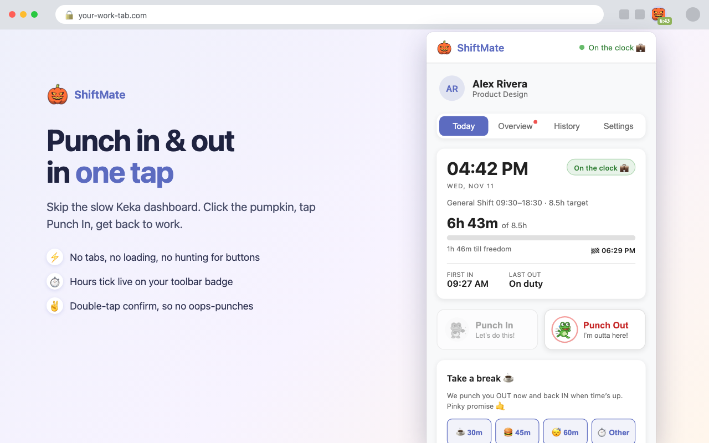

# ShiftMate — Keka Attendance for Chrome

A browser-toolbar companion for the [Keka](https://www.keka.com/) HR platform. Track work hours, clock in and out, take timed breaks, and let the extension handle the daily routine of punching in and out — from any `*.keka.com` workspace, without ever opening the Keka tab.

Built as a Manifest V3 extension for Chrome and Firefox. Not affiliated with Keka HR Technologies Pvt Ltd.

**[Website](https://pankaj1980patel.github.io/shiftmaker/)** · **[Chrome Web Store](https://chromewebstore.google.com/detail/kjglhonepkcmbcapgbnnihoihhanhdee)** · **[Releases](https://github.com/pankaj1980patel/shiftmaker/releases/latest)**



> **Keywords**: Keka, attendance, timesheet, time tracking, clock in / clock out, punch in / punch out, auto clock-in, auto clock-out, work hours, leave balance, holidays, birthdays, Chrome extension.

## Features

- **One-click punch in / out** from the browser toolbar — no need to open Keka in a tab.
- **Smart timed breaks** (30 / 45 / 60 min or custom). Punches you out, runs a countdown, and auto-clocks you back in. Desktop notification confirms the result.
- **Scheduled auto clock-in** — set a daily time; if you have zero punches that day, ShiftMate punches you in for you. Skips holidays, weekly offs and full-day leave (switchable).
- **Auto break** — set a time window (e.g. 13:00–14:00) and a length; once a day, while you're clocked in, ShiftMate punches you out inside that window and back in after the break. Skipped if you already took a break in the window.
- **Scheduled auto clock-out** — set a daily time-of-day; ShiftMate punches you out if you're still clocked in past it. If you re-punch in by hand, you get a desktop notification asking whether to punch out again or handle it yourself (throttled to once per day).
- **Multi-tenant** — works for any `*.keka.com` workspace. Auto-detected from an open Keka tab or the session cookie; falls back to a workspace prompt on the sign-in form.
- **Live progress badge** on the pumpkin toolbar icon: gradient from red at 0h to green at your shift length (e.g. 8.5h, from Keka), updated every minute. Hover for clocked-in state and hours.
- **Location on punches** — when your company requires it, the real device location is attached (as Keka's web app does); punches still go through without it if location is unavailable.
- **Today / Overview / History tabs**:
  - Today: in/out times, total hours, day status (holiday, weekly off, leave, shift), timed breaks, upcoming birthdays with a one-click copyable wish (customisable message).
  - Overview: pending approvals and unread notifications (click to open Keka), leave balances, upcoming holidays, who's on leave today.
  - History: previous days with weekend/leave badges.
- **Reminders** — morning birthday notification and new-approval alerts (each switchable in Settings).
- **Frictionless sign-in**:
  - Auto-detects an existing Keka session in an open tab.
  - In-popup email + password + captcha form when no session exists, including Keka's two-factor (OTP by email or mobile) step.
  - Power-user fallback: paste a refresh token directly.

## Installation (development)

**Chrome**
1. Clone this repo.
2. Open `chrome://extensions/`.
3. Toggle **Developer mode** (top-right).
4. Click **Load unpacked** and pick this folder.

**Firefox** (128 or newer)
1. Run `node scripts/build.mjs`.
2. Open `about:debugging#/runtime/this-firefox`.
3. Click **Load Temporary Add-on…** and pick `dist/firefox/manifest.json`.

## Building store packages

`node scripts/build.mjs` writes `dist/shiftmate-chrome-v<version>.zip` (Chrome Web Store) and `dist/shiftmate-firefox-v<version>.zip` (addons.mozilla.org) from the same source. The Firefox manifest swaps the service worker for an event page (which has geolocation, so no offscreen document), and adds a gecko ID and the data-collection disclosure.

## Project layout

```
manifest.json          # MV3 manifest (Chrome; Firefox variant generated by scripts/build.mjs)
scripts/build.mjs      # Builds the Chrome and Firefox store zips into dist/
src/
  background.js        # Service worker: alarms, badge, auto in/out, reminders
  offscreen.html / offscreen.js      # Hidden page: device location for the service worker
  popup.html / popup.js / popup.css  # Popup UI
  utils/
    api.js             # Authenticated fetch + token refresh + punch (with location)
    auth-login.js      # OIDC PKCE login flow (email + password + captcha + OTP)
    birthdays.js       # Upcoming colleague birthdays
    grab-tokens.js     # Scrape OIDC tokens from an open Keka tab
    location.js        # Device location (popup directly, worker via offscreen page)
    storage.js         # Storage wrapper: tokens in local, settings in sync
    tenant.js          # Per-tenant subdomain resolution and discovery
    workday.js         # Shift, holidays, leave, team on leave, inbox counts
docs/
  index.html           # Landing page (GitHub Pages)
  privacy.html         # Privacy policy
```

## Privacy

All data stays in your own Chrome profile; sign-in tokens are kept on this device only (`chrome.storage.local`), settings sync with your Chrome profile. The extension talks only to Keka's own servers (`*.keka.com`). When your company requires a location for web clock-in, your device location is sent to Keka with each punch, as Keka's own web app does. See the [privacy policy](https://pankaj1980patel.github.io/shiftmaker/privacy.html).

## License

MIT
